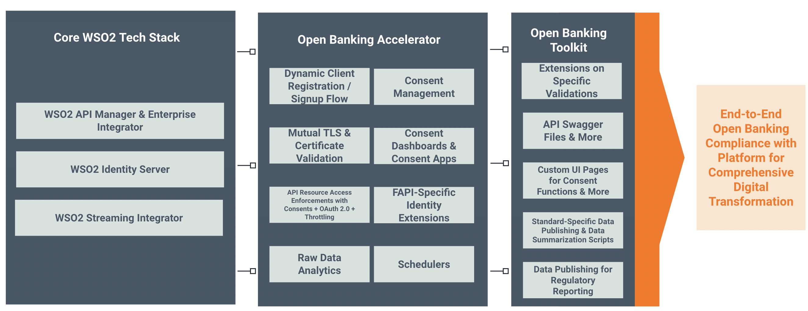

import {FeatureTiles, FeatureTile, SectionSummaries, SectionSummary} from '@site/src/components/HomePage';

<header className="ob-home__hero">
  <h1>Welcome to the WSO2 Open Banking UK Toolkit Documentation!</h1>
  

    Open Banking UK Toolkit delivers end-to-end compliance for OBIE’s Open Banking Standard. It increases the speed and reduces the complexity of adopting open banking compliance. Instead of building a solution from scratch, you can simply deploy WSO2 Open Banking UK Toolkit to meet all legislative requirements with additional benefits beyond compliance.
  

  

    The toolkit runs on top of WSO2 Identity Server, WSO2 API Manager, and WSO2 Streaming Integrator. Get a head start with our Quick Start Guide or dive straight into the documentation to understand what we offer.
  

</header>

<FeatureTiles>
  <FeatureTile to="/get-started/quick-start-guide/" icon="timer" title="Quick Start Guide" hint="Set up and try out in your local environment" />
  <FeatureTile to="/learn/consent-management/" icon="consent" title="Consent Management" hint="Create, view, revoke, and manage consents" />
  <FeatureTile to="/learn/dynamic-client-registration/" icon="register" title="Dynamic Client Registration" hint="A thorough verification before onboarding" />
  <FeatureTile to="/learn/api-security/" icon="shield" title="Secured API Invocation" hint="Comprehensive support of FAPI and eIDAS certificate validation" />
  <FeatureTile to="/learn/data-publishing/" icon="chart" title="Analytics and Data Publishing" hint="Publish and summarize data for reporting" />
  <FeatureTile to="/learn/integration-with-bank/" icon="plug" title="Easily Pluggable" hint="Easy integration with core banking systems" />
</FeatureTiles>

<h2 className="ob-home__heading">Explore the documentation</h2>

<SectionSummaries>
  <SectionSummary
    to="/get-started/wso2-open-banking-uk-toolkit/"
    icon="book"
    title="Get Started"
    description="Learn about the toolkit and the regulations it supports, then set up a working environment."
    links={[
      {to: '/get-started/wso2-open-banking-uk-toolkit/', label: 'WSO2 Open Banking UK Toolkit'},
      {to: '/get-started/open-banking/', label: 'Open Banking'},
      {to: '/get-started/regulations-and-standards/', label: 'Regulations and Standards'},
      {to: '/get-started/quick-start-guide/', label: 'Quick Start Guide'},
    ]}
  />
  <SectionSummary
    to="/install-and-setup/prerequisites/"
    icon="download"
    title="Install and Setup"
    description="Install, configure and upgrade the toolkit with the WSO2 products it runs on."
    links={[
      {to: '/install-and-setup/prerequisites/', label: 'Prerequisites'},
      {to: '/install-and-setup/setting-up-servers/', label: 'Setting up servers'},
      {to: '/install-and-setup/setting-up-databases/', label: 'Setting up databases'},
      {to: '/install-and-setup/upgrading-the-solution/', label: 'Upgrading the solution'},
    ]}
  />
  <SectionSummary
    to="/learn/consent-management/"
    icon="cap"
    title="Learn"
    description="Understand how the consent, onboarding and authentication features of the toolkit work."
    links={[
      {to: '/learn/consent-management/', label: 'Consent Management'},
      {to: '/learn/dynamic-client-registration/', label: 'Dynamic Client Registration'},
      {to: '/learn/token-authentication/', label: 'Token Authentication'},
      {to: '/learn/strong-customer-authentication/', label: 'Strong Customer Authentication'},
    ]}
  />
  <SectionSummary
    to="/try-out/dynamic-client-registration-flow/"
    icon="flask"
    title="Try out"
    description="Try out the flows of the toolkit on your own deployment."
    links={[
      {to: '/try-out/dynamic-client-registration-flow/', label: 'TPP Onboarding'},
      {to: '/try-out/account-and-transaction-flow/', label: 'Account and transaction flow'},
      {to: '/try-out/payment-initiation-flow/', label: 'Payment Initiation flow'},
      {to: '/try-out/confirmation-of-funds-flow/', label: 'Confirmation of Funds flow'},
    ]}
  />
  <SectionSummary
    to="/conformance/functional-conformance-suite/"
    icon="check"
    title="Conformance"
    description="Verify your deployment with the conformance test suite."
    links={[
      {to: '/conformance/functional-conformance-suite/', label: 'Functional Conformance Suite'},
    ]}
  />
</SectionSummaries>

